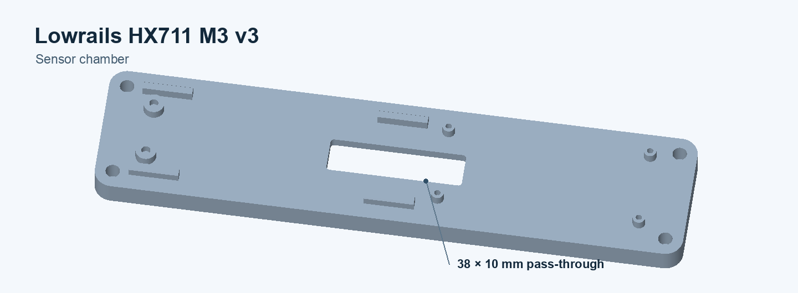
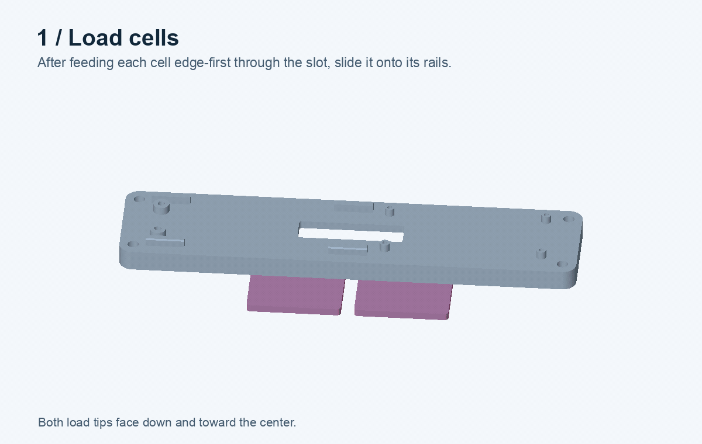
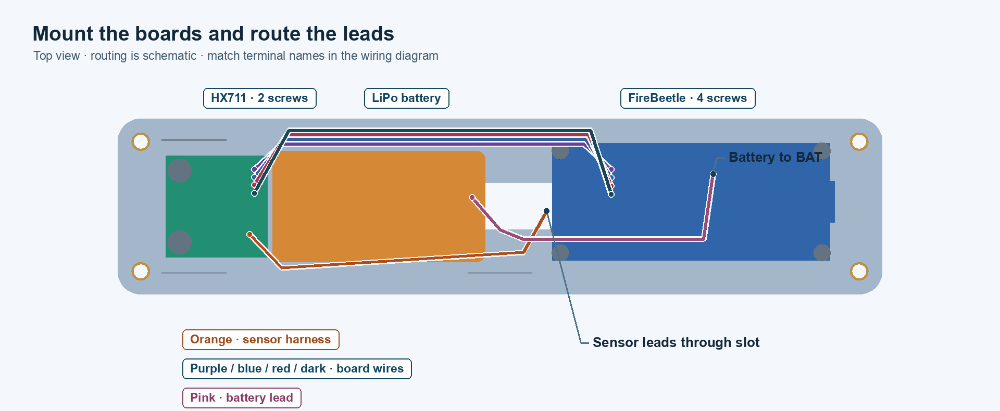
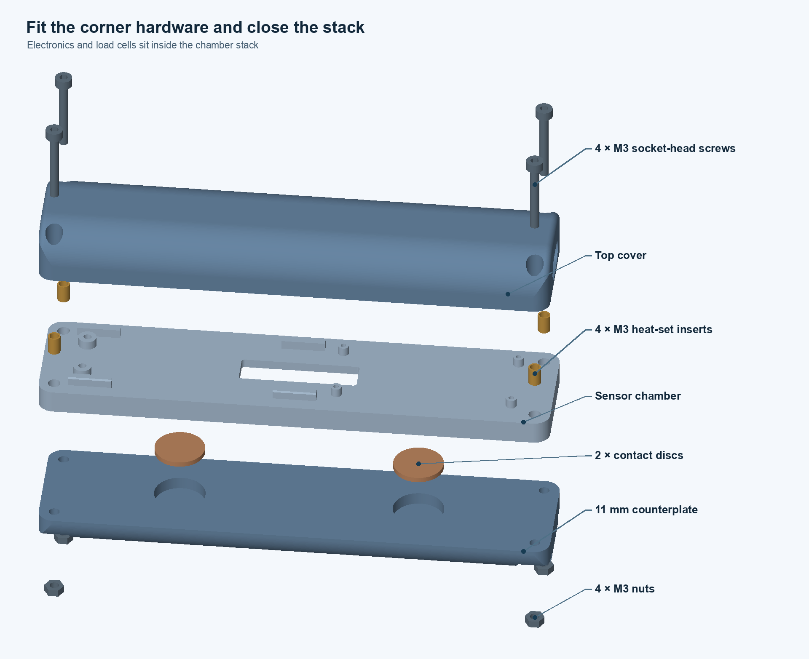

# ForceGripper

## 3D model

[Open or download the full v3 STEP assembly](model/forcegripper_v3.step). It includes the enclosure, two load cells and contact discs, the HX711 breakout, the FireBeetle 2 ESP32-C6, the battery, and the fasteners.



- **Printable parts:** [Sensor chamber](model/sensor_chamber.stl), [top cover](model/top_cover.stl), and [11 mm counterplate](model/counterplate.stl).
- **Component reference models:** [34 × 34 mm load cell](model/components/load_cell.stl), [two-hole HX711 breakout](model/components/hx711.stl), [FireBeetle 2 ESP32-C6](model/components/firebeetle.stl), and [46 × 24 × 8.4 mm battery](model/components/battery.stl).

The electronics, load cell details, and battery are simplified clearance models. The HX711 reference uses the v3 mounting pattern with two holes spaced 15.5 mm apart. Check your breakout and battery dimensions, including connectors and wires, before assembly. The FireBeetle board outline is 60 × 25.4 mm. [DFRobot specifications](https://wiki.dfrobot.com/dfr1075)

Regenerate all models in millimeters with Python 3.12:

```sh
python3.12 -m venv .venv
.venv/bin/python -m pip install -r model/requirements.txt
.venv/bin/python model/assembly.py
```

Pass an output directory to export elsewhere. Run [sensor_chamber.py](model/sensor_chamber.py) to regenerate just the chamber.

## Assembly



### 1. Install the load cells

With the counterplate off, pass each 34 mm cell edge-first through the lengthwise slot. Rotate it flat with the load tip facing down and toward the center. Slide it along the rails toward its end stop. Bring the leads back up through the slot.


### 2. Mount and wire the electronics

Mount the HX711 on the two M3 bosses and the FireBeetle on the four M2 bosses. Face the USB-C port toward the cover opening. Place the battery between the boards and keep the center slot and corner screw paths clear. Use screws that engage the pilot holes without bottoming out.



With USB and the battery disconnected, wire the boards as shown. Use a breakout that supports 3.3 V supply and logic. If the breakout has a RATE selector, set it to 80 samples/s for this firmware. Connect a compatible battery to **BAT** after checking the plug polarity. [FireBeetle pinout](https://wiki.dfrobot.com/dfr1075/#pinout) · [HX711 pinout](https://docs.soldered.com/hx711/hardware/)


| FireBeetle 2 ESP32-C6 | HX711 |
| --- | --- |
| 3V3 | VCC |
| GND | GND |
| D3 / GPIO14 | DAT / DT / DOUT |
| D2 / GPIO8 | SCK / CLK |

The firmware reads **channel A**. Connect a verified bridge's excitation pair to **E+ / E−** and its signal pair to **A+ / A−**. The installed cells' part numbers and two-cell bridge wiring are unconfirmed. Use the sensor datasheet or trace the existing harness to identify the leads before connecting it. [HX711 bridge terminals](https://docs.soldered.com/hx711/hardware/#pin-details-regular-version)

### 3. Fit the contact discs and corner hardware

Fit four M3 heat-set inserts in the chamber's corner bores. Place two one-cent euro coins in the counterplate pockets, with the pockets facing the load tips. Lower the top cover over the electronics. Feed four M3 socket-head screws through the cover and inserts, then fit four M3 nuts from below.

The STEP uses approximately 23 mm of shaft below each corner screw head as a fit reference. Check the actual stack height and screw engagement on your print before selecting the screws. Before tightening, confirm the load tips move freely and the wires stay clear of the rails and cover seam.



## Firmware

Flash [ForceGripper.ino](firmware/ForceGripper/ForceGripper.ino) to a DFRobot FireBeetle 2 ESP32-C6. Use the [wiring map above](#2-mount-and-wire-the-electronics).

In Arduino IDE, install the **esp32** board package, **HX711** by Rob Tillaart, and **NimBLE-Arduino**. Select **DFRobot FireBeetle 2 ESP32-C6** then set **Tools → USB CDC On Boot → Enabled** and **Tools → Partition Scheme → Minimal SPIFFS**. The build was checked with ESP32 core 3.3.8, HX711 0.6.3, and NimBLE-Arduino 2.5.0.

```sh
arduino-cli compile --fqbn esp32:esp32:dfrobot_firebeetle2_esp32c6:CDCOnBoot=cdc,PartitionScheme=min_spiffs firmware/ForceGripper
arduino-cli compile --upload -p YOUR_PORT --fqbn esp32:esp32:dfrobot_firebeetle2_esp32c6:CDCOnBoot=cdc,PartitionScheme=min_spiffs firmware/ForceGripper
```

## Connections

USB serial and BLE are enabled by default. Enable Wi-Fi at the top of the sketch before flashing to use it alongside them. All transports report signed raw HX711 counts.

| Connection | How to read samples |
| --- | --- |
| USB serial | Open the board's USB port at **115200 baud**. Each sample is one CSV line, `seq,t_us,raw`. The port can also show startup messages and command responses. |
| BLE | Connect to **HX711_Wake_v1** and subscribe to characteristic **FFF1** under service **FFF0**. Send control commands to **FFF2**. |
| Wi-Fi access point | Set `WIFI_MODE` to `WifiMode::AccessPoint`. Set an AP password of at least eight characters and join the network named by `WIFI_AP_SSID`. Read the latest sample at `http://192.168.4.1/reading`. |
| Wi-Fi on an existing network | Set `WIFI_MODE` to `WifiMode::Station` and fill in the SSID and password locally. The board prints its IP over USB after joining. Read the latest sample at `http://BOARD_IP/reading`. |

Wi-Fi `GET /reading` returns JSON with `seq`, `t_us`, and `raw`. For a live UDP stream, set `WIFI_UDP_TARGET` to the receiver's IPv4 address. The board then sends one CSV line per sample to UDP port **5005**.

Each BLE sample notification contains `0xA6`, a one-byte sample count (normally 3), the first sample's sequence and timestamp as unsigned 32-bit values, and one signed 24-bit raw value per sample. All multi-byte values are little-endian. The batch stores the first timestamp only. Clients can estimate the following times at 12,500 µs intervals. Sequence numbers and microsecond timestamps wrap at 32 bits. USB and BLE accept commands such as `STATUS?` and `BASELINE:CAPTURE`. Command responses over BLE are text on the same notification characteristic.

## Python examples

Install the reader dependencies in the same virtual environment. Each example writes `seq,t_us,raw` CSV to standard output. Append `> samples.csv` to record a session and press Ctrl+C to stop.

```sh
.venv/bin/python -m pip install -r examples/requirements.txt

# USB serial. List ports with python -m serial.tools.list_ports.
.venv/bin/python examples/read_serial.py /dev/cu.usbmodem101

# BLE. Uses HX711_Wake_v1 by default.
.venv/bin/python examples/read_ble.py

# Wi-Fi HTTP. Use the board's IP for station mode.
.venv/bin/python examples/read_wifi.py http 192.168.4.1

# Wi-Fi UDP. Set WIFI_UDP_TARGET to this computer's IPv4 address before flashing.
.venv/bin/python examples/read_wifi.py udp
```

Use UDP for the Wi-Fi sample stream. HTTP polls the latest reading, so it can repeat or skip sample numbers. The BLE reader estimates the timestamps after the first sample of each batch.
