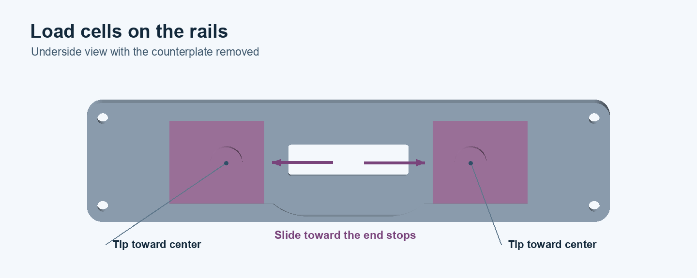
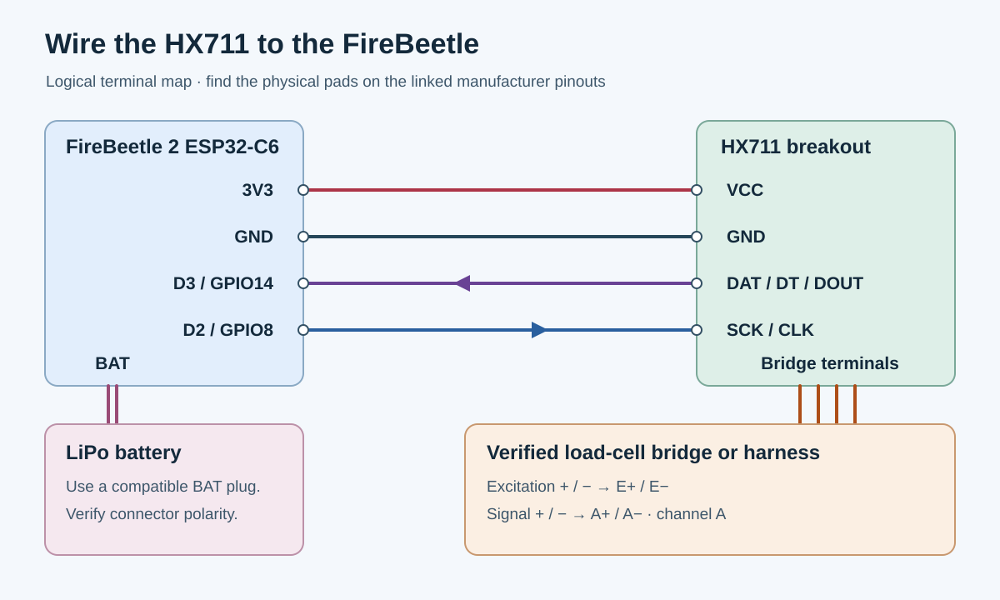

# ForceGripper

Lowrails HX711 M3 v3 force gripper. [Full STEP assembly](model/forcegripper_v3.step) · [Firmware](firmware/ForceGripper/ForceGripper.ino) · [Python readers](#read-samples)

## Parts for one gripper

| Qty | Part |
| ---: | --- |
| 1 each | [Sensor chamber](model/sensor_chamber.stl), [top cover](model/top_cover.stl), [11 mm counterplate](model/counterplate.stl) |
| 2 | 34 × 34 mm three-wire half-bridge load cells. Part number unconfirmed. |
| 1 | [Soldered HX711 breakout, 333005](https://solde.red/333005) |
| 1 | [DFRobot FireBeetle 2 ESP32-C6, DFR1075](https://www.dfrobot.com/product-2771.html) |
| 1 | LiPo pack used in the build, **46 × 24 × 8.4 mm** measured. Brand and capacity unrecorded. |
| 4 each | M3 socket-head screws, M3 heat-set inserts, **M3 nylon nuts** |
| 2 / 4 | Short M3 screws for the HX711 / short M2 screws for the FireBeetle |
| 2 | One-cent euro coins for the counterplate |
| As needed | Hookup wire and heat-shrink tubing |

| Load cells (reference photo) | HX711 333005 | FireBeetle ESP32-C6 |
| :---: | :---: | :---: |
|  |  |  |

Photos from [Sensor and Control](https://sensor-con.com/product/sc134/), [DigiKey](https://www.digikey.com/en/products/detail/soldered-electronics/333005/21720457), and [DFRobot](https://www.dfrobot.com/product-2771.html).

## Build and wire

### 1. Fit both load cells

Feed each cell edge-first through the **38 × 10 mm** slot. Turn it flat with the tip facing down and toward the center, then slide it to its end stop. Bring both sets of leads back up through the slot.



### 2. Mount and connect the boards

Fasten the HX711 to the two M3 bosses and the FireBeetle to the four M2 bosses. Face USB-C toward the cover opening. Place the battery between the boards.

Before wiring, disconnect USB and the battery. Check each cell on its own with a meter. **White–black should be the highest resistance**, about twice either red-to-end reading if red is the center tap. Then make two separate splices and insulate each with heat-shrink. [SparkFun lead reference](https://docs.sparkfun.com/SparkFun_OpenScale_IoT/single_page/#load-sensor-combinator)



Use the board pinouts to locate the pads. Check battery plug polarity before connecting to **BAT**. With power on, press each tip separately. Both should move the reading in the same direction. Swap the red leads at **A+** and **A−** if both readings move opposite to the desired sign. [HX711 pinout](https://docs.soldered.com/hx711/hardware/) · [FireBeetle pinout](https://wiki.dfrobot.com/dfr1075/#pinout)

### 3. Close the enclosure

Seat the four heat-set inserts in the chamber and the two coins in the counterplate pockets, facing the load tips. Fit the cover and counterplate with the four corner screws and **M3 nylon nuts**. Check screw engagement, free tip movement, and wire clearance before tightening. [Exploded fastener view](model/images/exploded-assembly.png)

## Flash the firmware

In Arduino IDE, install **esp32**, **HX711** by Rob Tillaart, and **NimBLE-Arduino**. Select **DFRobot FireBeetle 2 ESP32-C6**, set **USB CDC On Boot** to **Enabled** and **Partition Scheme** to **Minimal SPIFFS**, then upload [ForceGripper.ino](firmware/ForceGripper/ForceGripper.ino).

The BLE reader estimates timestamps within each batch at 80 samples/s. For a stock 10 samples/s HX711, use USB or UDP when sample timing matters. [Soldered 333005 specifications](https://solde.red/333005)

## Read samples

USB serial and BLE work by default. For Wi-Fi, set `WIFI_MODE` in the sketch before flashing. Use `WifiMode::AccessPoint` for `192.168.4.1`, or `WifiMode::Station` for your local network and read the board IP over USB. For UDP, set `WIFI_UDP_TARGET` to your computer’s IPv4 address.

```sh
python3.12 -m venv .venv
.venv/bin/python -m pip install -r examples/requirements.txt
.venv/bin/python examples/read_serial.py /dev/cu.usbmodem101
.venv/bin/python examples/read_ble.py
.venv/bin/python examples/read_wifi.py http 192.168.4.1
.venv/bin/python examples/read_wifi.py udp
```

The readers print `seq,t_us,raw` CSV. Append `> samples.csv` to record it.

## Regenerate the CAD

```sh
.venv/bin/python -m pip install -r model/requirements.txt
.venv/bin/python model/assembly.py
```
